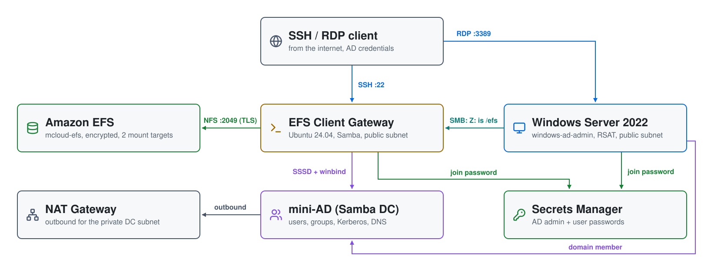
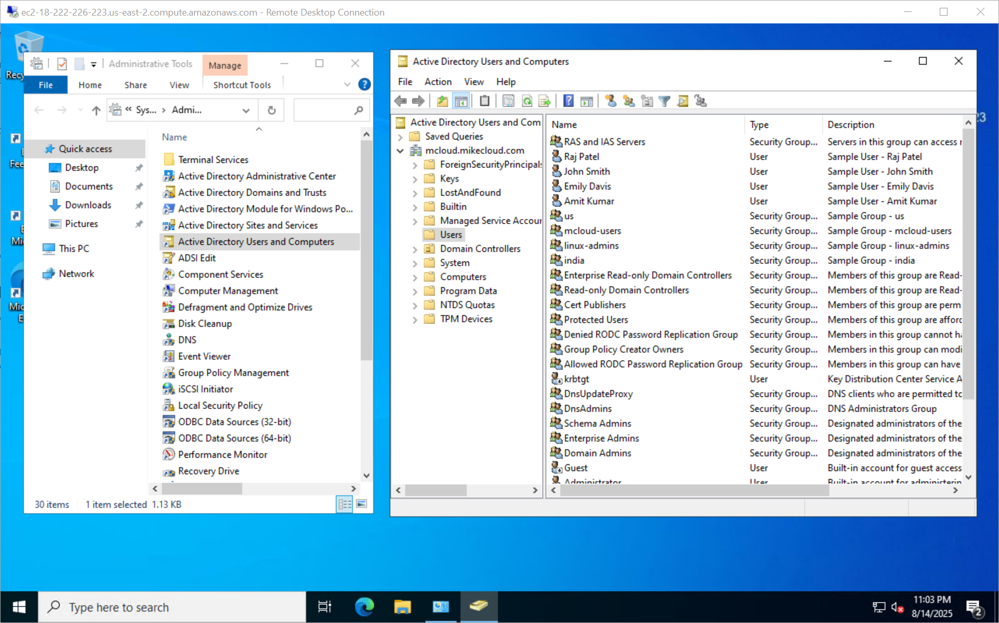

# Amazon EFS + Active Directory on AWS: NFS and Samba File Sharing

Shared, elastic file storage for Linux and Windows, backed by **Amazon EFS**
and secured with a **mini-AD** domain. A Linux gateway mounts EFS over NFS
for home directories and a shared area, and re-shares that area over **SMB**,
so Windows hosts reach the same files as a mapped drive. Every login uses an
AD account.

| Piece | Where | Role |
|---|---|---|
| **EFS client gateway** | public subnet | Ubuntu 24.04; joined to AD with SSSD; mounts EFS as `/efs` and `/home`; shares `/efs` through Samba; SSH from the internet |
| **Windows Server 2022** | public subnet | joined to AD; RSAT for managing users; maps the gateway's `efs` share as `Z:` |
| **mini-AD** (Samba DC) | private subnet | users, groups, POSIX IDs, DNS, Kerberos |
| **Amazon EFS** | both subnets | encrypted file system with a mount target in each subnet |
| **Secrets Manager** | regional | AD admin and user passwords |
| **NAT gateway** | public subnet | outbound internet for the DC's private subnet |

## Architecture

<picture>
  <source media="(prefers-color-scheme: dark)" srcset="architecture-dark.svg">
  
</picture>

Regenerate with `python3 make_diagram.py`.

- **`01-directory/`**: the VPC (`efs-vpc`, 10.0.0.0/24), a public VM subnet,
  a private DC subnet, the NAT gateway, the AD passwords in Secrets Manager,
  and the
  [`module-aws-mini-ad`](https://github.com/mamonaco1973/module-aws-mini-ad)
  Samba DC with users and POSIX attributes from `users.json`.
- **`02-servers/`**: the EFS file system and its two mount targets, the EFS
  client gateway and Windows hosts, their IAM role and security groups.

## Why a Samba gateway

EFS speaks NFS only. Linux mounts it directly; Windows can't, so the gateway
mounts EFS and serves the same directory over SMB. Samba runs in ADS mode
with SSSD as its ID map backend, so a file written as `jsmith` on Linux is
owned by `MCLOUD\jsmith` on Windows, with the same POSIX IDs from AD.

For Windows-native SMB features (ACLs, DFS, shadow copies), FSx for Windows
File Server is the managed alternative to this pattern.

## How the share works

1. At boot the gateway installs `amazon-efs-utils` and mounts the EFS root as
   `/efs` and `/efs/home` as `/home`, both with the `tls` option, so NFS
   traffic is encrypted in transit.
2. It reads the AD admin password from Secrets Manager and joins the domain
   with `realm join`. SSSD is set for short names (`jsmith`, not
   `jsmith@mcloud.mikecloud.com`) and the POSIX IDs stored in AD.
3. Samba shares `/efs` as `efs` and each user's home as `homes`. New files are
   group `mcloud-users`, mode `0770`. `/efs/data` is the shared area for
   `mcloud-users`; each home directory is `0700`.
4. The gateway clones this repository into `/efs/aws-efs`, so the share has
   content from the start.
5. The Windows host joins the same domain, allows `mcloud-users` to sign in
   over RDP, and maps `\\<gateway>\efs` as `Z:` at every login.
6. Members of **`linux-admins`** get passwordless sudo on the gateway.

| User | Groups | sudo on the gateway |
|---|---|---|
| jsmith | mcloud-users, us, linux-admins, Domain Admins | yes |
| edavis | mcloud-users, us | no |
| rpatel | mcloud-users, india, linux-admins, Domain Admins | yes |
| akumar | mcloud-users, india | no |

| Group | gidNumber |
|---|---|
| mcloud-users | 10001 |
| us | 10002 |
| india | 10003 |
| linux-admins | 10004 |

## Security groups

```
internet ─22, 445─▶ EFS client gateway ─2049─▶ EFS mount targets
internet ─3389────▶ Windows ─445─▶ gateway (Z: is /efs)
```

Both hosts are open to `0.0.0.0/0` on their ports; every login still needs
an AD account. The EFS mount targets and the DC have no public address. Admin
access to both hosts is also available through **SSM Session Manager**.

## Prerequisites

* [An AWS Account](https://aws.amazon.com/console/)
* [Install AWS CLI](https://docs.aws.amazon.com/cli/latest/userguide/getting-started-install.html)
* [Install Terraform](https://developer.hashicorp.com/terraform/install)
* [Install jq](https://jqlang.github.io/jq/download/)

If this is your first time watching our content, we recommend starting with
this video: [AWS + Terraform: Easy Setup](https://youtu.be/BCMQo0CB9wk).

## Deploy

```bash
git clone https://github.com/mamonaco1973/aws-efs.git
cd aws-efs
./apply.sh       # 1: VPC + mini-AD + secrets  2: EFS, gateway, Windows
```

Everything deploys to `us-east-1`. After `apply.sh` finishes, the gateway
needs a few minutes to mount EFS and join the domain. The Windows host takes
longer, because it joins and then reboots.

`apply.sh` ends by running `validate.sh`, which prints the two hosts:

```
============================================================================
EFS + Active Directory Quick Start - Validation Output
============================================================================

NOTE: Windows RDP Host FQDN: ec2-203-0-113-10.compute-1.amazonaws.com
NOTE: Linux SSH Host FQDN:  ec2-203-0-113-20.compute-1.amazonaws.com

NOTE: Validation complete.
```

## Try it

1. Get a user's password from Secrets Manager:

   ```bash
   aws secretsmanager get-secret-value --secret-id rpatel_ad_credentials_efs \
     --query SecretString --output text | jq -r .password
   ```

   Each user has a `<user>_ad_credentials_efs` secret; the domain admin is
   `admin_ad_credentials_efs`.

2. SSH to the **Linux SSH Host** as `rpatel`. Try `df -h /efs /home`,
   `ls -l /efs /efs/home` and `id`. The EFS mounts show as `127.0.0.1`,
   because `efs-utils` sends NFS through a local TLS tunnel.

   

3. RDP to the **Windows RDP Host** as `MCLOUD\rpatel`. `Z:` is the gateway's
   `/efs`: the same `home` and `data` folders, and the cloned repository.

   

4. Create a file in `Z:\data` on Windows, then `ls -l /efs/data` on the
   gateway: it's owned by `rpatel`, group `mcloud-users`.

## Troubleshooting

| Symptom | Fix |
|---|---|
| SSH rejects every AD password | The gateway hasn't finished its domain join. `aws ssm start-session --target <instance-id>`, then `sudo cat /root/userdata.log`. |
| `/efs` or `/home` isn't mounted | Check the end of `/root/userdata.log` and `grep efs /etc/fstab`. The mount targets must exist before the gateway boots, which Terraform handles with `depends_on`. |
| `Z:` is missing on Windows | The Windows host joins the domain and reboots after deploy; give it time. The mapping runs from `map_drives.bat` in the all-users Startup folder at each login. The boot log is `C:\ProgramData\userdata.log`. |
| Windows can't reach `\\<gateway>\efs` | Samba runs on the gateway: `sudo systemctl status smbd winbind` there. |
| `id <user>` finds nothing | The user needs `uidNumber`, `gidNumber` and `uid` set in AD. SSSD caches lookups; `sudo sss_cache -E` clears it. |

## Teardown

```bash
./destroy.sh     # destroys phase 2, deletes the secrets, destroys phase 1
```

The secrets are deleted with no recovery window.

## Notes

- **Lab only.** SSH, RDP and SMB are open to the internet, jsmith and rpatel
  are Domain Admins, and the join uses the domain admin account. Restrict the
  security groups and use a dedicated join account for anything more.
- Users, groups and POSIX IDs are defined in
  `01-directory/scripts/users.json.template`.
